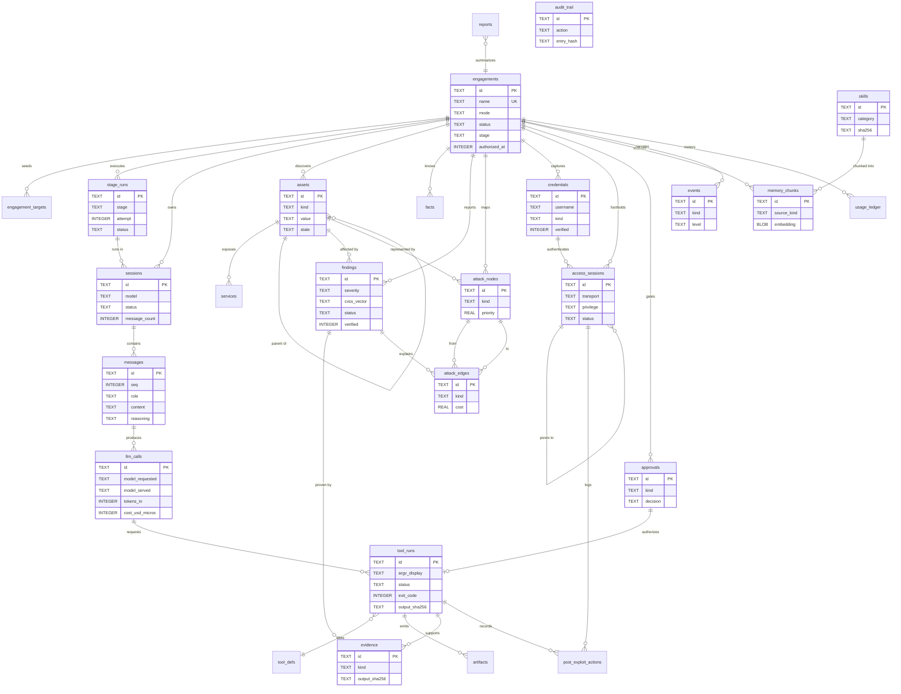

# Cosmics — Entity Relationship Design

**Version:** 1.0.0
**Status:** Approved for implementation (M0)
**Applies to:** `internal/store`, `internal/memory`

---

## 1. Design Principles

| # | Principle | Consequence |
|---|---|---|
| P1 | **The database is the engagement.** Process memory is a cache. | Every stage can resume from SQLite alone. |
| P2 | **Facts, not logs, are the agent's memory.** | Raw output lives in artifacts; the agent reads distilled facts. |
| P3 | **Append-only where truth matters.** | `events`, `tool_runs`, `llm_calls`, `approvals`, `audit_trail` have no UPDATE/DELETE path, enforced by triggers. |
| P4 | **Everything is addressable.** | All rows use TEXT ULID primary keys; references are stable across export/import. |
| P5 | **Supersede, never mutate.** | Semantic facts carry `superseded_by`; history is preserved. |
| P6 | **Evidence is first-class.** | A finding cannot exist without at least one evidence row, and an evidence row cannot exist without a producing `tool_run` or `llm_call`. |
| P7 | **JSON for leaves, columns for queries.** | Frequently filtered/scored attributes are columns; unstructured detail is JSON validated by Go structs. |

### 1.1 Conventions

- **Primary keys:** `TEXT` ULID (26 chars, lexicographically sortable, generated in Go).
- **Timestamps:** `INTEGER` Unix epoch **milliseconds, UTC**. All application code converts; no SQL `datetime()` reliance.
- **Booleans:** `INTEGER` 0/1 with `CHECK (col IN (0,1))`.
- **Enums:** `TEXT` with `CHECK (col IN (...))`. Changing an enum requires a migration.
- **JSON:** `TEXT` columns named `*_json`, always a JSON object or array, never a bare scalar.
- **Money:** `INTEGER` micro-USD (1 USD = 1,000,000) to avoid float drift.
- **Hashes:** lowercase hex SHA-256, 64 chars.
- **Foreign keys:** `PRAGMA foreign_keys = ON`, `ON DELETE` chosen per relation.

### 1.2 SQLite settings

```sql
PRAGMA journal_mode = WAL;
PRAGMA foreign_keys = ON;
PRAGMA busy_timeout = 5000;
PRAGMA synchronous = NORMAL;
PRAGMA temp_store = MEMORY;
PRAGMA mmap_size = 134217728;
```

**Concurrency model:** one writer connection (serialized through a Go mutex-guarded `*sql.DB` with `SetMaxOpenConns(1)` for writes) and a separate read pool (`SetMaxOpenConns(4)`). WAL permits concurrent readers during a write. Rationale is recorded in `ARCHITECTURE.md §7`.

---

## 2. Domain Map

```
                            ┌──────────────┐
                            │ engagements  │
                            └──────┬───────┘
        ┌──────────────────────────┼───────────────────────────┐
        │                          │                           │
  ┌─────▼──────┐            ┌──────▼──────┐             ┌──────▼──────┐
  │ stage_runs │            │  sessions   │             │   assets    │
  └─────┬──────┘            └──────┬──────┘             └──────┬──────┘
        │                          │                           │
        │                    ┌─────▼──────┐              ┌─────▼──────┐
        │                    │  messages  │              │  services  │
        │                    └─────┬──────┘              └─────┬──────┘
        │                          │                           │
        │                    ┌─────▼──────┐                    │
        │                    │ llm_calls  │                    │
        │                    └─────┬──────┘                    │
        │                          │                           │
        │                    ┌─────▼──────┐              ┌─────▼──────┐
        └───────────────────▶│ tool_runs  │─────────────▶│  findings  │
                             └─────┬──────┘              └─────┬──────┘
                                   │                           │
                             ┌─────▼──────┐              ┌─────▼──────┐
                             │ artifacts  │─────────────▶│  evidence  │
                             └────────────┘              └────────────┘
```

---

## 3. Entity Reference

### 3.1 `engagements`

The root aggregate. One row per assessment.

| Column | Type | Notes |
|---|---|---|
| `id` | TEXT PK | ULID |
| `name` | TEXT NOT NULL | Human label, unique per DB |
| `client` | TEXT | Optional client/organization |
| `mode` | TEXT NOT NULL | `recon` \| `assess` \| `exploit` \| `full` |
| `status` | TEXT NOT NULL | `draft` \| `ready` \| `running` \| `paused` \| `completed` \| `failed` \| `aborted` |
| `stage` | TEXT NOT NULL | Current stage: `none` \| `recon` \| `osint` \| `analysis` \| `mapper` \| `exploit` \| `reporting` \| `done` |
| `model_profile` | TEXT NOT NULL | Key into `config.yaml` model routing |
| `authorized_by` | TEXT NOT NULL | Name/handle of the authorizing party |
| `authorization_note` | TEXT | Free text recorded at creation |
| `authorized_at` | INTEGER NOT NULL | ms epoch; set once, never updated |
| `budget_usd_micros` | INTEGER NOT NULL DEFAULT 0 | 0 = unlimited |
| `spent_usd_micros` | INTEGER NOT NULL DEFAULT 0 | Denormalized rollup, recomputed on write |
| `token_budget` | INTEGER NOT NULL DEFAULT 0 | 0 = unlimited |
| `tokens_used` | INTEGER NOT NULL DEFAULT 0 | Denormalized rollup |
| `created_at`, `updated_at` | INTEGER NOT NULL | ms epoch |
| `started_at`, `finished_at` | INTEGER | nullable |
| `config_json` | TEXT NOT NULL DEFAULT '{}' | Per-engagement overrides (tool timeouts, model lists) |
| `error` | TEXT | Last fatal error, if `status = failed` |

**Constraints**
```sql
CHECK (mode IN ('recon','assess','exploit','full'))
CHECK (status IN ('draft','ready','running','paused','completed','failed','aborted'))
CHECK (stage IN ('none','recon','osint','analysis','mapper','exploit','reporting','done'))
CHECK (budget_usd_micros >= 0)
UNIQUE (name)
```

**Rules**
- `authorized_at` is set at creation; a trigger rejects any later change.
- `status` transitions are validated in Go against an explicit matrix; the DB additionally forbids leaving a terminal state (`completed`/`failed`/`aborted`) except to `ready` via an explicit "reopen" operation that is itself audited.

---

### 3.2 `engagement_targets`

Seed targets supplied by the operator. Derived assets are *not* stored here.

| Column | Type | Notes |
|---|---|---|
| `id` | TEXT PK | |
| `engagement_id` | TEXT NOT NULL FK → `engagements(id)` ON DELETE CASCADE | |
| `kind` | TEXT NOT NULL | `domain` \| `host` \| `ip` \| `cidr` \| `url` \| `repo` \| `binary` |
| `value` | TEXT NOT NULL | Normalized canonical form |
| `raw` | TEXT | As typed by operator |
| `note` | TEXT | |
| `created_at` | INTEGER NOT NULL | |

`UNIQUE (engagement_id, kind, value)`

---

### 3.3 `stage_runs`

One row per execution of a stage. Supports re-runs and comparison.

| Column | Type | Notes |
|---|---|---|
| `id` | TEXT PK | |
| `engagement_id` | TEXT NOT NULL FK ON DELETE CASCADE | |
| `stage` | TEXT NOT NULL | same enum as `engagements.stage` minus `none`/`done` |
| `attempt` | INTEGER NOT NULL | 1-based, increments per re-run |
| `status` | TEXT NOT NULL | `pending` \| `running` \| `succeeded` \| `failed` \| `skipped` \| `aborted` |
| `session_id` | TEXT FK → `sessions(id)` | Agent session used for this stage |
| `plan_json` | TEXT | LLM-generated plan, if any |
| `summary` | TEXT | LLM or deterministic stage summary |
| `started_at`, `finished_at` | INTEGER | |
| `tool_run_count`, `finding_count`, `fact_count` | INTEGER DEFAULT 0 | Rollups |
| `tokens_in`, `tokens_out`, `cost_usd_micros` | INTEGER DEFAULT 0 | Rollups |
| `iterations` | INTEGER DEFAULT 0 | Agent loop iterations consumed |
| `error` | TEXT | |

`UNIQUE (engagement_id, stage, attempt)`

**Exit criteria are recorded, not inferred:** `stage_runs.summary` plus the presence of facts of the stage's contract keys determine `succeeded`. See `FLOWCHART.md` for the per-stage predicate table.

---

### 3.4 `sessions`

An agent conversation thread. A session spans one stage by default; a "continuous" session may span stages when the operator requests it.

| Column | Type | Notes |
|---|---|---|
| `id` | TEXT PK | |
| `engagement_id` | TEXT NOT NULL FK ON DELETE CASCADE | |
| `stage_run_id` | TEXT FK → `stage_runs(id)` ON DELETE SET NULL | |
| `title` | TEXT | |
| `model` | TEXT NOT NULL | Resolved model id actually used |
| `system_prompt_hash` | TEXT NOT NULL | SHA-256 of the assembled system prompt |
| `context_window` | INTEGER | Model's window, from provider metadata |
| `status` | TEXT NOT NULL | `open` \| `closed` \| `compacted` |
| `message_count` | INTEGER DEFAULT 0 | |
| `last_compaction_at` | INTEGER | |
| `compaction_summary` | TEXT | Rolling summary replacing pruned messages |
| `created_at`, `updated_at` | INTEGER NOT NULL | |

---

### 3.5 `messages`

Normalized conversation turns, provider-agnostic.

| Column | Type | Notes |
|---|---|---|
| `id` | TEXT PK | |
| `session_id` | TEXT NOT NULL FK ON DELETE CASCADE | |
| `seq` | INTEGER NOT NULL | Monotonic within session |
| `role` | TEXT NOT NULL | `system` \| `user` \| `assistant` \| `tool` |
| `content` | TEXT | Text payload (may be empty when only tool calls) |
| `reasoning` | TEXT | Reasoning/thinking text, separate from `content` |
| `content_blocks_json` | TEXT | Ordered blocks: text, tool_use, tool_result, image |
| `tool_calls_json` | TEXT | Assistant tool invocations, normalized |
| `tool_call_id` | TEXT | For `role='tool'` rows, the id being answered |
| `token_in`, `token_out` | INTEGER | |
| `pruned` | INTEGER NOT NULL DEFAULT 0 | 1 when compacted out of context |
| `created_at` | INTEGER NOT NULL | |

`UNIQUE (session_id, seq)` — plus index `(session_id, pruned, seq)` for context assembly.

**Why both `content` and `content_blocks_json`:** `content` keeps FTS simple and makes transcripts greppable; the blocks preserve provider structure for exact replay.

---

### 3.6 `llm_calls`

One row per provider request. The unit of cost accounting and replay.

| Column | Type | Notes |
|---|---|---|
| `id` | TEXT PK | |
| `engagement_id` | TEXT NOT NULL FK ON DELETE CASCADE | |
| `session_id` | TEXT FK ON DELETE SET NULL | |
| `message_id` | TEXT FK → `messages(id)` ON DELETE SET NULL | The assistant message produced |
| `stage` | TEXT NOT NULL | |
| `provider` | TEXT NOT NULL | `openai_compatible` \| `anthropic` |
| `model_requested` | TEXT NOT NULL | From config/fallback chain |
| `model_served` | TEXT | Actual model per response (may differ via combo fallback) |
| `fallback_index` | INTEGER DEFAULT 0 | 0 = primary |
| `purpose` | TEXT NOT NULL | `stage_plan` \| `tool_select` \| `output_parse` \| `summarize` \| `report_write` \| `compact` |
| `request_json` | TEXT NOT NULL | Redacted request body (API keys stripped) |
| `response_json` | TEXT | Redacted response body |
| `status` | TEXT NOT NULL | `ok` \| `error` \| `timeout` \| `rate_limited` \| `cancelled` |
| `http_status` | INTEGER | |
| `error_code`, `error_message` | TEXT | |
| `tokens_in`, `tokens_out`, `tokens_cached` | INTEGER DEFAULT 0 | |
| `cost_usd_micros` | INTEGER DEFAULT 0 | From model price table |
| `latency_ms` | INTEGER | |
| `streamed` | INTEGER NOT NULL DEFAULT 0 | |
| `reasoning_tokens` | INTEGER DEFAULT 0 | |
| `started_at`, `finished_at` | INTEGER NOT NULL | |

Indices: `(engagement_id, stage)`, `(session_id, seq_hint)` via `started_at`, `(status)`.

**Append-only.** No update path after `finished_at` is set.

---

### 3.7 `tool_defs`

Registry catalog. Seeded from embedded YAML; refreshed on startup (update allowed — this is reference data, not evidence).

| Column | Type | Notes |
|---|---|---|
| `id` | TEXT PK | Stable slug, e.g. `nmap`, `nuclei` |
| `category` | TEXT NOT NULL | `recon` \| `osint` \| `web` \| `network` \| `exploit` \| `post` \| `report` |
| `display_name` | TEXT NOT NULL | |
| `image` | TEXT NOT NULL | Docker image ref |
| `image_digest` | TEXT | Pinned digest once resolved |
| `binary` | TEXT NOT NULL | Entrypoint binary |
| `version_cmd` | TEXT | Probe argv, e.g. `["--version"]` |
| `arg_schema_json` | TEXT NOT NULL | JSON Schema for LLM-supplied args |
| `command_template` | TEXT NOT NULL | argv template with `{{.arg}}` placeholders |
| `capabilities_json` | TEXT | Docker caps needed, e.g. `["NET_RAW"]` |
| `network_mode` | TEXT | `bridge` (default) \| `host` \| `none` |
| `default_timeout_s` | INTEGER NOT NULL DEFAULT 300 | |
| `max_output_bytes` | INTEGER NOT NULL DEFAULT 262144 | Context truncation budget |
| `danger_level` | TEXT NOT NULL DEFAULT 'safe' | `safe` \| `intrusive` \| `destructive` |
| `requires_approval` | INTEGER NOT NULL DEFAULT 0 | |
| `enabled` | INTEGER NOT NULL DEFAULT 1 | |
| `notes` | TEXT | Fidelity caveats (e.g. SYN scan under Docker NAT) |
| `updated_at` | INTEGER NOT NULL | |

---

### 3.8 `tool_runs`

Every container execution. The atomic unit of offensive action.

| Column | Type | Notes |
|---|---|---|
| `id` | TEXT PK | |
| `engagement_id` | TEXT NOT NULL FK ON DELETE CASCADE | |
| `stage_run_id` | TEXT FK ON DELETE SET NULL | |
| `llm_call_id` | TEXT FK ON DELETE SET NULL | Which model decision requested it |
| `approval_id` | TEXT FK → `approvals(id)` ON DELETE SET NULL | Present when approval was required |
| `tool_id` | TEXT NOT NULL FK → `tool_defs(id)` | |
| `argv_json` | TEXT NOT NULL | Exact argv array |
| `argv_display` | TEXT NOT NULL | Shell-quoted, for humans and reports |
| `image` | TEXT NOT NULL | Resolved image ref |
| `image_digest` | TEXT | `sha256:...` when known |
| `container_id` | TEXT | Short id |
| `network_mode` | TEXT NOT NULL | |
| `caps_json` | TEXT | Effective capabilities |
| `target` | TEXT | Normalized target this run was aimed at |
| `status` | TEXT NOT NULL | `queued` \| `running` \| `succeeded` \| `failed` \| `timeout` \| `cancelled` \| `rejected` |
| `exit_code` | INTEGER | |
| `stdout_artifact_id` | TEXT FK → `artifacts(id)` ON DELETE SET NULL | |
| `stderr_artifact_id` | TEXT FK → `artifacts(id)` ON DELETE SET NULL | |
| `output_preview` | TEXT | Truncated head/tail used in context |
| `output_sha256` | TEXT | Hash of combined stdout+stderr |
| `started_at`, `finished_at` | INTEGER NOT NULL | |
| `duration_ms` | INTEGER | |
| `parsed_json` | TEXT | Structured parser output (e.g. nmap XML → JSON) |
| `error` | TEXT | |

Indices: `(engagement_id, tool_id)`, `(stage_run_id)`, `(status)`, `(target)`.

**Append-only.**

---

### 3.9 `artifacts`

Content-addressed blobs on disk. The DB stores metadata only.

| Column | Type | Notes |
|---|---|---|
| `id` | TEXT PK | |
| `engagement_id` | TEXT NOT NULL FK ON DELETE CASCADE | |
| `kind` | TEXT NOT NULL | `tool_stdout` \| `tool_stderr` \| `http_capture` \| `screenshot` \| `dump` \| `loot` \| `report` \| `pcap` |
| `rel_path` | TEXT NOT NULL | Path under the engagement workspace |
| `media_type` | TEXT | |
| `byte_size` | INTEGER NOT NULL | |
| `sha256` | TEXT NOT NULL | |
| `encoding` | TEXT | `utf-8` \| `binary` \| `gzip` |
| `sensitive` | INTEGER NOT NULL DEFAULT 0 | Excluded from reports by default |
| `created_at` | INTEGER NOT NULL | |

`UNIQUE (engagement_id, sha256, rel_path)`

Workspace layout is specified in `ARCHITECTURE.md §9`.

---

### 3.10 `assets`

Discovered surface. A self-referencing tree.

| Column | Type | Notes |
|---|---|---|
| `id` | TEXT PK | |
| `engagement_id` | TEXT NOT NULL FK ON DELETE CASCADE | |
| `parent_id` | TEXT FK → `assets(id)` ON DELETE CASCADE | |
| `kind` | TEXT NOT NULL | `domain` \| `subdomain` \| `ip` \| `host` \| `url` \| `endpoint` \| `repo` \| `bucket` \| `mobile_app` \| `api` |
| `value` | TEXT NOT NULL | Canonical form (normalized host:port, normalized URL) |
| `display` | TEXT | Original form for reports |
| `state` | TEXT NOT NULL DEFAULT 'unknown' | `unknown` \| `alive` \| `dead` \| `filtered` |
| `confidence` | REAL NOT NULL DEFAULT 1.0 | 0..1 |
| `first_seen_at`, `last_seen_at` | INTEGER NOT NULL | |
| `source` | TEXT NOT NULL | Producing tool id or `operator` |
| `attrs_json` | TEXT NOT NULL DEFAULT '{}' | tech stack, headers, title, TLS info |
| `tags_json` | TEXT | `["prod","cdn","interesting"]` |

`UNIQUE (engagement_id, kind, value)`

Index: `(engagement_id, kind, state)`, `(parent_id)`.

---

### 3.11 `services`

Ports and protocol detail, attached to an asset.

| Column | Type | Notes |
|---|---|---|
| `id` | TEXT PK | |
| `asset_id` | TEXT NOT NULL FK ON DELETE CASCADE | |
| `port` | INTEGER NOT NULL | |
| `protocol` | TEXT NOT NULL | `tcp` \| `udp` |
| `state` | TEXT NOT NULL | `open` \| `closed` \| `filtered` \| `open|filtered` |
| `service` | TEXT | `http`, `ssh`, `smb`, ... |
| `product`, `version`, `banner` | TEXT | |
| `tls_json` | TEXT | cert subject/issuer/SANs/expiry/weakness flags |
| `source_tool_run_id` | TEXT FK ON DELETE SET NULL | |
| `updated_at` | INTEGER NOT NULL | |

`UNIQUE (asset_id, port, protocol)`

---

### 3.12 `facts`

Semantic memory: durable, queryable statements about the engagement.

| Column | Type | Notes |
|---|---|---|
| `id` | TEXT PK | |
| `engagement_id` | TEXT NOT NULL FK ON DELETE CASCADE | |
| `subject` | TEXT NOT NULL | Asset value, host, or `engagement` |
| `predicate` | TEXT NOT NULL | Namespaced, e.g. `web.tech`, `auth.mechanism`, `net.open_port` |
| `value` | TEXT NOT NULL | Textual value; JSON when structured |
| `value_type` | TEXT NOT NULL DEFAULT 'text' | `text` \| `number` \| `bool` \| `json` \| `ref` |
| `confidence` | REAL NOT NULL DEFAULT 0.8 | 0..1 |
| `source_kind` | TEXT NOT NULL | `tool_run` \| `llm_inference` \| `operator` \| `osint` |
| `source_id` | TEXT | tool_run id / llm_call id |
| `stage` | TEXT NOT NULL | Producing stage |
| `superseded_by` | TEXT FK → `facts(id)` ON DELETE SET NULL | |
| `created_at` | INTEGER NOT NULL | |

Index: `(engagement_id, subject, predicate, superseded_by)`, FTS on `value`.

**Supersession rule:** writing a fact with the same `(engagement_id, subject, predicate)` and higher or equal confidence sets the prior row's `superseded_by` to the new id inside the same transaction. Retrieval filters `superseded_by IS NULL`.

---

### 3.13 `findings`

A confirmed or suspected weakness.

| Column | Type | Notes |
|---|---|---|
| `id` | TEXT PK | |
| `engagement_id` | TEXT NOT NULL FK ON DELETE CASCADE | |
| `stage_run_id` | TEXT FK ON DELETE SET NULL | |
| `title` | TEXT NOT NULL | |
| `category` | TEXT NOT NULL | `web` \| `network` \| `cloud` \| `mobile` \| `crypto` \| `auth` \| `config` \| `data_exposure` \| `access_control` |
| `wstg_id` | TEXT | e.g. `WSTG-ATHN-01` |
| `attack_technique_ids_json` | TEXT | e.g. `["T1190"]` |
| `severity` | TEXT NOT NULL | `critical` \| `high` \| `medium` \| `low` \| `info` |
| `confidence` | TEXT NOT NULL | `confirmed` \| `likely` \| `possible` |
| `cvss_vector` | TEXT | CVSS v4.0 vector string |
| `cvss_score` | REAL | 0.0–10.0 |
| `asset_id` | TEXT FK → `assets(id)` ON DELETE SET NULL | |
| `endpoint` | TEXT | URL or `host:port/path` |
| `parameter` | TEXT | |
| `description` | TEXT NOT NULL | Markdown |
| `impact` | TEXT | Markdown |
| `remediation` | TEXT | Markdown |
| `reproduction` | TEXT | Markdown, deterministic steps |
| `status` | TEXT NOT NULL DEFAULT 'open' | `open` \| `false_positive` \| `accepted_risk` \| `fixed` \| `retest` |
| `verified` | INTEGER NOT NULL DEFAULT 0 | 1 when an evidence row is a successful PoC |
| `created_at`, `updated_at` | INTEGER NOT NULL | |

**Invariant (enforced in Go + a deferred trigger):** a row with `status='open'` and `verified=1` must have ≥ 1 row in `evidence`.

---

### 3.14 `evidence`

The bridge between a finding and the run that proves it.

| Column | Type | Notes |
|---|---|---|
| `id` | TEXT PK | |
| `finding_id` | TEXT NOT NULL FK → `findings(id)` ON DELETE CASCADE | |
| `tool_run_id` | TEXT FK → `tool_runs(id)` ON DELETE SET NULL | |
| `llm_call_id` | TEXT FK ON DELETE SET NULL | For reasoning-derived evidence |
| `artifact_id` | TEXT FK → `artifacts(id)` ON DELETE SET NULL | |
| `kind` | TEXT NOT NULL | `poc` \| `observation` \| `screenshot` \| `output_excerpt` \| `reasoning` |
| `excerpt` | TEXT | Bounded excerpt shown in report |
| `command` | TEXT | Denormalized argv for report portability |
| `captured_at` | INTEGER NOT NULL | |
| `output_sha256` | TEXT | Copied from the producing run for tamper evidence |
| `note` | TEXT | |

Every evidence row must reference **at least one** of `tool_run_id` / `llm_call_id` / `artifact_id` (CHECK constraint).

---

### 3.15 `attack_nodes` / `attack_edges`

The Mapper stage's graph.

| `attack_nodes` | Type | Notes |
|---|---|---|
| `id` | TEXT PK | |
| `engagement_id` | TEXT NOT NULL FK ON DELETE CASCADE | |
| `asset_id` | TEXT FK ON DELETE SET NULL | |
| `node_key` | TEXT NOT NULL | Stable identity within engagement |
| `kind` | TEXT NOT NULL | `asset` \| `service` \| `credential` \| `session` \| `vuln` \| `goal` \| `data` |
| `label` | TEXT NOT NULL | |
| `attrs_json` | TEXT | |
| `reachable` | INTEGER NOT NULL DEFAULT 1 | |
| `priority` | REAL NOT NULL DEFAULT 0 | Model/operator-assigned |
| `created_at`, `updated_at` | INTEGER NOT NULL | |

`UNIQUE (engagement_id, node_key)`

| `attack_edges` | Type | Notes |
|---|---|---|
| `id` | TEXT PK | |
| `engagement_id` | TEXT NOT NULL FK ON DELETE CASCADE | |
| `from_node_id` | TEXT NOT NULL FK → `attack_nodes(id)` ON DELETE CASCADE | |
| `to_node_id` | TEXT NOT NULL FK → `attack_nodes(id)` ON DELETE CASCADE | |
| `kind` | TEXT NOT NULL | `can_reach` \| `exploits` \| `yields` \| `authenticates_to` \| `pivots_to` \| `exfiltrates` |
| `technique` | TEXT | ATT&CK id or tool id |
| `cost` | REAL | Effort/likelihood proxy |
| `confidence` | REAL | |
| `finding_id` | TEXT FK ON DELETE SET NULL | |
| `created_at` | INTEGER NOT NULL | |

`UNIQUE (engagement_id, from_node_id, to_node_id, kind)`

---

### 3.16 `credentials`

Captured or supplied secret material. Encrypted at rest.

| Column | Type | Notes |
|---|---|---|
| `id` | TEXT PK | |
| `engagement_id` | TEXT NOT NULL FK ON DELETE CASCADE | |
| `asset_id` | TEXT FK ON DELETE SET NULL | |
| `username` | TEXT | |
| `secret_ciphertext` | BLOB NOT NULL | AEAD ciphertext |
| `secret_nonce` | BLOB NOT NULL | |
| `secret_kdf` | TEXT NOT NULL | `argon2id` \| `os_keyring` |
| `secret_hint` | TEXT | e.g. `password, 14 chars` — never the value |
| `kind` | TEXT NOT NULL | `password` \| `ntlm` \| `ssh_key` \| `token` \| `cookie` \| `cert` |
| `source_tool_run_id` | TEXT FK ON DELETE SET NULL | |
| `valid_until` | INTEGER | |
| `verified` | INTEGER NOT NULL DEFAULT 0 | |
| `created_at` | INTEGER NOT NULL | |

**Never** selected into any LLM context in plaintext. The agent receives only `username`, `kind`, `verified`, and an opaque `credential_id` for use as a `{{.credential}}` placeholder resolved inside the executor.

---

### 3.17 `access_sessions`

Exploitation footholds ("sessions" in pentest vocabulary).

| Column | Type | Notes |
|---|---|---|
| `id` | TEXT PK | |
| `engagement_id` | TEXT NOT NULL FK ON DELETE CASCADE | |
| `parent_id` | TEXT FK → `access_sessions(id)` ON DELETE SET NULL | Pivot chain |
| `asset_id` | TEXT FK ON DELETE SET NULL | |
| `label` | TEXT NOT NULL | e.g. `www01 as www-data` |
| `transport` | TEXT NOT NULL | `reverse_shell` \| `bind_shell` \| `ssh` \| `winrm` \| `smb` \| `web_shell` \| `meterpreter` \| `rce` |
| `credential_id` | TEXT FK → `credentials(id)` ON DELETE SET NULL | |
| `privilege` | TEXT | `user` \| `sudo` \| `system` \| `domain_admin` \| `root` |
| `status` | TEXT NOT NULL | `active` \| `lost` \| `closed` |
| `opened_by_tool_run_id` | TEXT FK ON DELETE SET NULL | |
| `opened_at`, `closed_at` | INTEGER NOT NULL / NULL | |
| `notes` | TEXT | |

---

### 3.18 `post_exploit_actions`

Chronological record of activity inside an access session.

| Column | Type | Notes |
|---|---|---|
| `id` | TEXT PK | |
| `access_session_id` | TEXT NOT NULL FK ON DELETE CASCADE | |
| `tool_run_id` | TEXT FK ON DELETE SET NULL | |
| `seq` | INTEGER NOT NULL | |
| `action` | TEXT NOT NULL | `enumerate` \| `escalate` \| `dump` \| `pivot` \| `persist` \| `exfil` \| `cleanup` |
| `attack_technique_id` | TEXT | ATT&CK id |
| `command` | TEXT | |
| `result_summary` | TEXT | |
| `artifact_id` | TEXT FK ON DELETE SET NULL | |
| `success` | INTEGER NOT NULL | |
| `created_at` | INTEGER NOT NULL | |

---

### 3.19 `approvals`

Human-in-the-loop gate records.

| Column | Type | Notes |
|---|---|---|
| `id` | TEXT PK | |
| `engagement_id` | TEXT NOT NULL FK ON DELETE CASCADE | |
| `tool_run_id` | TEXT FK → `tool_runs(id)` ON DELETE SET NULL | Bound after approval |
| `requested_by_llm_call_id` | TEXT FK ON DELETE SET NULL | |
| `kind` | TEXT NOT NULL | `destructive_action` \| `exploit_launch` \| `credential_use` \| `data_access` |
| `command_preview` | TEXT NOT NULL | Exact argv shown to operator |
| `reason` | TEXT NOT NULL | Agent's stated justification |
| `decision` | TEXT NOT NULL | `pending` \| `approved` \| `denied` \| `expired` |
| `decided_at` | INTEGER | |
| `decided_by` | TEXT | Operator identity from config |
| `expires_at` | INTEGER NOT NULL | |
| `created_at` | INTEGER NOT NULL | |

**Append-only on decision** — a decided approval cannot be re-decided; a new request is required.

---

### 3.20 `skills`

Index of procedural memory. The files on disk are the source of truth; this table is the searchable index.

| Column | Type | Notes |
|---|---|---|
| `id` | TEXT PK | Slug from front matter or filename |
| `name` | TEXT NOT NULL | |
| `category` | TEXT NOT NULL | `recon` \| `osint` \| `web` \| `network` \| `cloud` \| `mobile` \| `exploit` \| `post` \| `report` \| `meta` |
| `description` | TEXT NOT NULL | |
| `version` | TEXT | From front matter |
| `path` | TEXT NOT NULL | Absolute path at load time |
| `sha256` | TEXT NOT NULL | Content hash — triggers reindex on change |
| `stage_affinity_json` | TEXT | `["recon","analysis"]` |
| `tags_json` | TEXT | |
| `when_to_use` | TEXT | From front matter |
| `token_estimate` | INTEGER | Cost guard before injection |
| `enabled` | INTEGER NOT NULL DEFAULT 1 | |
| `indexed_at` | INTEGER NOT NULL | |

`UNIQUE (path)` and index on `(category, enabled)`.

---

### 3.21 `memory_chunks`

RAG unit for hybrid retrieval over skills, facts, events, and artifacts.

| Column | Type | Notes |
|---|---|---|
| `id` | TEXT PK | |
| `engagement_id` | TEXT FK ON DELETE CASCADE | NULL = global (skills, lessons) |
| `source_kind` | TEXT NOT NULL | `skill` \| `fact` \| `event` \| `finding` \| `artifact_excerpt` \| `lesson` |
| `source_id` | TEXT NOT NULL | Row id in the source table |
| `chunk_index` | INTEGER NOT NULL DEFAULT 0 | |
| `text` | TEXT NOT NULL | |
| `token_estimate` | INTEGER NOT NULL | |
| `embedding_model` | TEXT | NULL = keyword-only |
| `embedding_dim` | INTEGER | |
| `embedding` | BLOB | `float32` little-endian, `dim*4` bytes |
| `created_at` | INTEGER NOT NULL | |

`UNIQUE (source_kind, source_id, chunk_index, embedding_model)`

**Storage decision:** embeddings are stored as a `BLOB` of packed `float32` with `embedding_dim` alongside. Retrieval uses FTS5 for candidate generation (top ~200 by bm25), then cosine similarity in Go over that candidate set. `modernc.org/sqlite/vec` (sqlite-vec v0.1.9) is available without cgo and can back a `vec0` index behind the same interface, but its ingest cost measured 15.5 s for 20k vectors against ~18 ms for a warm in-Go scan — see `ARCHITECTURE.md §8.4`. The `BLOB` representation is therefore the primary path, not a fallback.

`memory_chunks.embedding` stays `NULL` unless an embedding provider is configured; the column exists so enabling vectors never requires a migration.

---

### 3.22 `events`

Episodic memory and the human-readable activity feed. Append-only.

| Column | Type | Notes |
|---|---|---|
| `id` | TEXT PK | |
| `engagement_id` | TEXT NOT NULL FK ON DELETE CASCADE | |
| `stage` | TEXT | |
| `session_id` | TEXT FK ON DELETE SET NULL | |
| `tool_run_id` | TEXT FK ON DELETE SET NULL | |
| `kind` | TEXT NOT NULL | `stage_start` \| `stage_end` \| `tool_start` \| `tool_end` \| `llm_call` \| `fact_set` \| `finding_added` \| `approval_requested` \| `approval_decided` \| `session_opened` \| `error` \| `note` \| `operator_command` |
| `level` | TEXT NOT NULL | `debug` \| `info` \| `warn` \| `error` |
| `message` | TEXT NOT NULL | One-line human summary |
| `detail_json` | TEXT | Structured payload |
| `created_at` | INTEGER NOT NULL | |

Indices: `(engagement_id, created_at)`, `(kind, created_at)`. FTS on `message`.

---

### 3.23 `audit_trail`

The immutable record that survives even if engagement data is deleted. Deliberately **not** FK-cascaded.

| Column | Type | Notes |
|---|---|---|
| `id` | TEXT PK | |
| `engagement_id` | TEXT | No FK — survives deletion |
| `actor` | TEXT NOT NULL | `operator` \| `agent` \| `system` |
| `action` | TEXT NOT NULL | `engagement_created` \| `authorization_recorded` \| `target_added` \| `tool_executed` \| `exploit_launched` \| `credential_captured` \| `data_accessed` \| `report_generated` \| `config_changed` |
| `target` | TEXT | |
| `command` | TEXT | Full argv where applicable |
| `outcome` | TEXT NOT NULL | `allowed` \| `denied` \| `error` |
| `detail_json` | TEXT | |
| `prev_hash` | TEXT | Hash chain: SHA-256 of previous row's `entry_hash` |
| `entry_hash` | TEXT NOT NULL | SHA-256 of canonical fields + `prev_hash` |
| `created_at` | INTEGER NOT NULL | |

**Hash chain** makes retroactive tampering detectable: `verify` recomputes the chain. Triggers reject UPDATE and DELETE unconditionally.

---

### 3.24 `reports`

| Column | Type | Notes |
|---|---|---|
| `id` | TEXT PK | |
| `engagement_id` | TEXT NOT NULL FK ON DELETE CASCADE | |
| `format` | TEXT NOT NULL | `markdown` \| `html` |
| `template_version` | TEXT NOT NULL | |
| `artifact_id` | TEXT FK → `artifacts(id)` ON DELETE SET NULL | |
| `finding_count` | INTEGER NOT NULL | |
| `severity_counts_json` | TEXT NOT NULL | `{"critical":1,"high":2,...}` |
| `generated_at` | INTEGER NOT NULL | |
| `db_snapshot_hash` | TEXT NOT NULL | Hash of the deterministic report input set |

---

### 3.25 `usage_ledger`

Budget enforcement and cost attribution. Append-only.

| Column | Type | Notes |
|---|---|---|
| `id` | TEXT PK | |
| `engagement_id` | TEXT NOT NULL FK ON DELETE CASCADE | |
| `stage` | TEXT | |
| `kind` | TEXT NOT NULL | `llm` \| `tool` |
| `ref_id` | TEXT NOT NULL | `llm_calls.id` or `tool_runs.id` |
| `tokens_in`, `tokens_out` | INTEGER DEFAULT 0 | |
| `cost_usd_micros` | INTEGER DEFAULT 0 | |
| `created_at` | INTEGER NOT NULL | |

Budget check reads `SUM(cost_usd_micros)` per engagement before each LLM call and each tool run.

---

### 3.26 `schema_migrations`

| Column | Type | Notes |
|---|---|---|
| `version` | INTEGER PK | |
| `name` | TEXT NOT NULL | |
| `checksum` | TEXT NOT NULL | SHA-256 of the migration file |
| `applied_at` | INTEGER NOT NULL | |

---

## 4. Relationship Summary (Crow's Foot)



---

## 5. Full DDL

The canonical DDL is shipped as embedded migrations, not pasted here, to prevent drift. This section documents the **target shape** at migration `0001_init`.

```sql
-- 0001_init.sql (abridged: constraints, indices, triggers shown in full)

CREATE TABLE engagements (
    id                  TEXT PRIMARY KEY,
    name                TEXT NOT NULL UNIQUE,
    client              TEXT,
    mode                TEXT NOT NULL CHECK (mode IN ('recon','assess','exploit','full')),
    status              TEXT NOT NULL CHECK (status IN ('draft','ready','running','paused','completed','failed','aborted')),
    stage               TEXT NOT NULL CHECK (stage IN ('none','recon','osint','analysis','mapper','exploit','reporting','done')),
    model_profile       TEXT NOT NULL DEFAULT 'default',
    authorized_by       TEXT NOT NULL,
    authorization_note  TEXT,
    authorized_at       INTEGER NOT NULL,
    budget_usd_micros   INTEGER NOT NULL DEFAULT 0 CHECK (budget_usd_micros >= 0),
    spent_usd_micros    INTEGER NOT NULL DEFAULT 0,
    token_budget        INTEGER NOT NULL DEFAULT 0,
    tokens_used         INTEGER NOT NULL DEFAULT 0,
    created_at          INTEGER NOT NULL,
    updated_at          INTEGER NOT NULL,
    started_at          INTEGER,
    finished_at         INTEGER,
    config_json         TEXT NOT NULL DEFAULT '{}',
    error               TEXT
);

CREATE TRIGGER trg_engagements_authorization_immutable
BEFORE UPDATE OF authorized_by, authorized_at ON engagements
WHEN OLD.authorized_by <> NEW.authorized_by OR OLD.authorized_at <> NEW.authorized_at
BEGIN
    SELECT RAISE(ABORT, 'authorization record is immutable');
END;

CREATE TABLE engagement_targets (
    id            TEXT PRIMARY KEY,
    engagement_id TEXT NOT NULL REFERENCES engagements(id) ON DELETE CASCADE,
    kind          TEXT NOT NULL CHECK (kind IN ('domain','host','ip','cidr','url','repo','binary')),
    value         TEXT NOT NULL,
    raw           TEXT,
    note          TEXT,
    created_at    INTEGER NOT NULL,
    UNIQUE (engagement_id, kind, value)
);

CREATE TABLE stage_runs (
    id                TEXT PRIMARY KEY,
    engagement_id     TEXT NOT NULL REFERENCES engagements(id) ON DELETE CASCADE,
    stage             TEXT NOT NULL CHECK (stage IN ('recon','osint','analysis','mapper','exploit','reporting')),
    attempt           INTEGER NOT NULL CHECK (attempt >= 1),
    status            TEXT NOT NULL CHECK (status IN ('pending','running','succeeded','failed','skipped','aborted')),
    session_id        TEXT REFERENCES sessions(id) ON DELETE SET NULL,
    plan_json         TEXT,
    summary           TEXT,
    started_at        INTEGER,
    finished_at       INTEGER,
    tool_run_count    INTEGER NOT NULL DEFAULT 0,
    finding_count     INTEGER NOT NULL DEFAULT 0,
    fact_count        INTEGER NOT NULL DEFAULT 0,
    tokens_in         INTEGER NOT NULL DEFAULT 0,
    tokens_out        INTEGER NOT NULL DEFAULT 0,
    cost_usd_micros   INTEGER NOT NULL DEFAULT 0,
    iterations        INTEGER NOT NULL DEFAULT 0,
    error             TEXT,
    UNIQUE (engagement_id, stage, attempt)
);

CREATE TABLE sessions (
    id                  TEXT PRIMARY KEY,
    engagement_id       TEXT NOT NULL REFERENCES engagements(id) ON DELETE CASCADE,
    stage_run_id        TEXT REFERENCES stage_runs(id) ON DELETE SET NULL,
    title               TEXT,
    model               TEXT NOT NULL,
    system_prompt_hash  TEXT NOT NULL,
    context_window      INTEGER,
    status              TEXT NOT NULL CHECK (status IN ('open','closed','compacted')),
    message_count       INTEGER NOT NULL DEFAULT 0,
    last_compaction_at  INTEGER,
    compaction_summary  TEXT,
    created_at          INTEGER NOT NULL,
    updated_at          INTEGER NOT NULL
);

CREATE TABLE messages (
    id                  TEXT PRIMARY KEY,
    session_id          TEXT NOT NULL REFERENCES sessions(id) ON DELETE CASCADE,
    seq                 INTEGER NOT NULL,
    role                TEXT NOT NULL CHECK (role IN ('system','user','assistant','tool')),
    content             TEXT,
    reasoning           TEXT,
    content_blocks_json TEXT,
    tool_calls_json     TEXT,
    tool_call_id        TEXT,
    token_in            INTEGER NOT NULL DEFAULT 0,
    token_out           INTEGER NOT NULL DEFAULT 0,
    pruned              INTEGER NOT NULL DEFAULT 0 CHECK (pruned IN (0,1)),
    created_at          INTEGER NOT NULL,
    UNIQUE (session_id, seq)
);
CREATE INDEX idx_messages_ctx ON messages(session_id, pruned, seq);

CREATE TABLE llm_calls (
    id                TEXT PRIMARY KEY,
    engagement_id     TEXT NOT NULL REFERENCES engagements(id) ON DELETE CASCADE,
    session_id        TEXT REFERENCES sessions(id) ON DELETE SET NULL,
    message_id        TEXT REFERENCES messages(id) ON DELETE SET NULL,
    stage             TEXT NOT NULL,
    provider          TEXT NOT NULL CHECK (provider IN ('openai_compatible','anthropic')),
    model_requested   TEXT NOT NULL,
    model_served      TEXT,
    fallback_index    INTEGER NOT NULL DEFAULT 0,
    purpose           TEXT NOT NULL CHECK (purpose IN ('stage_plan','tool_select','output_parse','summarize','report_write','compact')),
    request_json      TEXT NOT NULL,
    response_json     TEXT,
    status            TEXT NOT NULL CHECK (status IN ('ok','error','timeout','rate_limited','cancelled')),
    http_status       INTEGER,
    error_code        TEXT,
    error_message     TEXT,
    tokens_in         INTEGER NOT NULL DEFAULT 0,
    tokens_out        INTEGER NOT NULL DEFAULT 0,
    tokens_cached     INTEGER NOT NULL DEFAULT 0,
    cost_usd_micros   INTEGER NOT NULL DEFAULT 0,
    latency_ms        INTEGER,
    streamed          INTEGER NOT NULL DEFAULT 0 CHECK (streamed IN (0,1)),
    reasoning_tokens  INTEGER NOT NULL DEFAULT 0,
    started_at        INTEGER NOT NULL,
    finished_at       INTEGER NOT NULL
);
CREATE INDEX idx_llm_calls_eng_stage ON llm_calls(engagement_id, stage);
CREATE INDEX idx_llm_calls_status ON llm_calls(status);

CREATE TRIGGER trg_llm_calls_no_update
BEFORE UPDATE ON llm_calls
BEGIN
    SELECT RAISE(ABORT, 'llm_calls is append-only');
END;
CREATE TRIGGER trg_llm_calls_no_delete
BEFORE DELETE ON llm_calls
BEGIN
    SELECT RAISE(ABORT, 'llm_calls is append-only');
END;

CREATE TABLE tool_defs (
    id                TEXT PRIMARY KEY,
    category          TEXT NOT NULL CHECK (category IN ('recon','osint','web','network','exploit','post','report')),
    display_name      TEXT NOT NULL,
    image             TEXT NOT NULL,
    image_digest      TEXT,
    binary            TEXT NOT NULL,
    version_cmd       TEXT,
    arg_schema_json   TEXT NOT NULL,
    command_template  TEXT NOT NULL,
    capabilities_json TEXT,
    network_mode      TEXT NOT NULL DEFAULT 'bridge' CHECK (network_mode IN ('bridge','host','none')),
    default_timeout_s INTEGER NOT NULL DEFAULT 300 CHECK (default_timeout_s > 0),
    max_output_bytes  INTEGER NOT NULL DEFAULT 262144,
    danger_level      TEXT NOT NULL DEFAULT 'safe' CHECK (danger_level IN ('safe','intrusive','destructive')),
    requires_approval INTEGER NOT NULL DEFAULT 0 CHECK (requires_approval IN (0,1)),
    enabled           INTEGER NOT NULL DEFAULT 1 CHECK (enabled IN (0,1)),
    notes             TEXT,
    updated_at        INTEGER NOT NULL
);

CREATE TABLE tool_runs (
    id                 TEXT PRIMARY KEY,
    engagement_id      TEXT NOT NULL REFERENCES engagements(id) ON DELETE CASCADE,
    stage_run_id       TEXT REFERENCES stage_runs(id) ON DELETE SET NULL,
    llm_call_id        TEXT REFERENCES llm_calls(id) ON DELETE SET NULL,
    approval_id        TEXT REFERENCES approvals(id) ON DELETE SET NULL,
    tool_id            TEXT NOT NULL REFERENCES tool_defs(id),
    argv_json          TEXT NOT NULL,
    argv_display       TEXT NOT NULL,
    image              TEXT NOT NULL,
    image_digest       TEXT,
    container_id       TEXT,
    network_mode       TEXT NOT NULL,
    caps_json          TEXT,
    target             TEXT,
    status             TEXT NOT NULL CHECK (status IN ('queued','running','succeeded','failed','timeout','cancelled','rejected')),
    exit_code          INTEGER,
    stdout_artifact_id TEXT REFERENCES artifacts(id) ON DELETE SET NULL,
    stderr_artifact_id TEXT REFERENCES artifacts(id) ON DELETE SET NULL,
    output_preview     TEXT,
    output_sha256      TEXT,
    started_at         INTEGER NOT NULL,
    finished_at        INTEGER,
    duration_ms        INTEGER,
    parsed_json        TEXT,
    error              TEXT
);
CREATE INDEX idx_tool_runs_eng_tool ON tool_runs(engagement_id, tool_id);
CREATE INDEX idx_tool_runs_stage ON tool_runs(stage_run_id);
CREATE INDEX idx_tool_runs_status ON tool_runs(status);
CREATE INDEX idx_tool_runs_target ON tool_runs(target);

CREATE TRIGGER trg_tool_runs_no_update_after_finish
BEFORE UPDATE ON tool_runs
WHEN OLD.finished_at IS NOT NULL
 AND (NEW.argv_display <> OLD.argv_display OR NEW.output_sha256 IS NOT OLD.output_sha256 OR NEW.exit_code IS NOT OLD.exit_code)
BEGIN
    SELECT RAISE(ABORT, 'finished tool_runs are append-only');
END;

CREATE TABLE artifacts (
    id            TEXT PRIMARY KEY,
    engagement_id TEXT NOT NULL REFERENCES engagements(id) ON DELETE CASCADE,
    kind          TEXT NOT NULL CHECK (kind IN ('tool_stdout','tool_stderr','http_capture','screenshot','dump','loot','report','pcap')),
    rel_path      TEXT NOT NULL,
    media_type    TEXT,
    byte_size     INTEGER NOT NULL,
    sha256        TEXT NOT NULL,
    encoding      TEXT NOT NULL DEFAULT 'utf-8' CHECK (encoding IN ('utf-8','binary','gzip')),
    sensitive     INTEGER NOT NULL DEFAULT 0 CHECK (sensitive IN (0,1)),
    created_at    INTEGER NOT NULL,
    UNIQUE (engagement_id, sha256, rel_path)
);

CREATE TABLE assets (
    id            TEXT PRIMARY KEY,
    engagement_id TEXT NOT NULL REFERENCES engagements(id) ON DELETE CASCADE,
    parent_id     TEXT REFERENCES assets(id) ON DELETE CASCADE,
    kind          TEXT NOT NULL CHECK (kind IN ('domain','subdomain','ip','host','url','endpoint','repo','bucket','mobile_app','api')),
    value         TEXT NOT NULL,
    display       TEXT,
    state         TEXT NOT NULL DEFAULT 'unknown' CHECK (state IN ('unknown','alive','dead','filtered')),
    confidence    REAL NOT NULL DEFAULT 1.0 CHECK (confidence BETWEEN 0.0 AND 1.0),
    first_seen_at INTEGER NOT NULL,
    last_seen_at  INTEGER NOT NULL,
    source        TEXT NOT NULL,
    attrs_json    TEXT NOT NULL DEFAULT '{}',
    tags_json     TEXT,
    UNIQUE (engagement_id, kind, value)
);
CREATE INDEX idx_assets_eng_kind_state ON assets(engagement_id, kind, state);
CREATE INDEX idx_assets_parent ON assets(parent_id);

CREATE TABLE services (
    id                TEXT PRIMARY KEY,
    asset_id          TEXT NOT NULL REFERENCES assets(id) ON DELETE CASCADE,
    port              INTEGER NOT NULL CHECK (port BETWEEN 1 AND 65535),
    protocol          TEXT NOT NULL CHECK (protocol IN ('tcp','udp')),
    state             TEXT NOT NULL CHECK (state IN ('open','closed','filtered','open|filtered')),
    service           TEXT,
    product           TEXT,
    version           TEXT,
    banner            TEXT,
    tls_json          TEXT,
    source_tool_run_id TEXT REFERENCES tool_runs(id) ON DELETE SET NULL,
    updated_at        INTEGER NOT NULL,
    UNIQUE (asset_id, port, protocol)
);

CREATE TABLE facts (
    id            TEXT PRIMARY KEY,
    engagement_id TEXT NOT NULL REFERENCES engagements(id) ON DELETE CASCADE,
    subject       TEXT NOT NULL,
    predicate     TEXT NOT NULL,
    value         TEXT NOT NULL,
    value_type    TEXT NOT NULL DEFAULT 'text' CHECK (value_type IN ('text','number','bool','json','ref')),
    confidence    REAL NOT NULL DEFAULT 0.8 CHECK (confidence BETWEEN 0.0 AND 1.0),
    source_kind   TEXT NOT NULL CHECK (source_kind IN ('tool_run','llm_inference','operator','osint')),
    source_id     TEXT,
    stage         TEXT NOT NULL,
    superseded_by TEXT REFERENCES facts(id) ON DELETE SET NULL,
    created_at    INTEGER NOT NULL
);
CREATE INDEX idx_facts_lookup ON facts(engagement_id, subject, predicate, superseded_by);

CREATE VIRTUAL TABLE facts_fts USING fts5(
    value, subject, predicate,
    content='facts', content_rowid='rowid', tokenize='porter unicode61'
);
CREATE TRIGGER facts_ai AFTER INSERT ON facts BEGIN
    INSERT INTO facts_fts(rowid, value, subject, predicate) VALUES (new.rowid, new.value, new.subject, new.predicate);
END;
CREATE TRIGGER facts_ad AFTER DELETE ON facts BEGIN
    INSERT INTO facts_fts(facts_fts, rowid, value, subject, predicate) VALUES ('delete', old.rowid, old.value, old.subject, old.predicate);
END;
CREATE TRIGGER facts_au AFTER UPDATE ON facts BEGIN
    INSERT INTO facts_fts(facts_fts, rowid, value, subject, predicate) VALUES ('delete', old.rowid, old.value, old.subject, old.predicate);
    INSERT INTO facts_fts(rowid, value, subject, predicate) VALUES (new.rowid, new.value, new.subject, new.predicate);
END;

CREATE TABLE findings (
    id                        TEXT PRIMARY KEY,
    engagement_id             TEXT NOT NULL REFERENCES engagements(id) ON DELETE CASCADE,
    stage_run_id              TEXT REFERENCES stage_runs(id) ON DELETE SET NULL,
    title                     TEXT NOT NULL,
    category                  TEXT NOT NULL CHECK (category IN ('web','network','cloud','mobile','crypto','auth','config','data_exposure','access_control')),
    wstg_id                   TEXT,
    attack_technique_ids_json TEXT,
    severity                  TEXT NOT NULL CHECK (severity IN ('critical','high','medium','low','info')),
    confidence                TEXT NOT NULL CHECK (confidence IN ('confirmed','likely','possible')),
    cvss_vector               TEXT,
    cvss_score                REAL CHECK (cvss_score IS NULL OR (cvss_score BETWEEN 0.0 AND 10.0)),
    asset_id                  TEXT REFERENCES assets(id) ON DELETE SET NULL,
    endpoint                  TEXT,
    parameter                 TEXT,
    description               TEXT NOT NULL,
    impact                    TEXT,
    remediation               TEXT,
    reproduction              TEXT,
    status                    TEXT NOT NULL DEFAULT 'open' CHECK (status IN ('open','false_positive','accepted_risk','fixed','retest')),
    verified                  INTEGER NOT NULL DEFAULT 0 CHECK (verified IN (0,1)),
    created_at                INTEGER NOT NULL,
    updated_at                INTEGER NOT NULL
);
CREATE INDEX idx_findings_sev ON findings(engagement_id, severity);
CREATE INDEX idx_findings_status ON findings(engagement_id, status);

CREATE TABLE evidence (
    id             TEXT PRIMARY KEY,
    finding_id     TEXT NOT NULL REFERENCES findings(id) ON DELETE CASCADE,
    tool_run_id    TEXT REFERENCES tool_runs(id) ON DELETE SET NULL,
    llm_call_id    TEXT REFERENCES llm_calls(id) ON DELETE SET NULL,
    artifact_id    TEXT REFERENCES artifacts(id) ON DELETE SET NULL,
    kind           TEXT NOT NULL CHECK (kind IN ('poc','observation','screenshot','output_excerpt','reasoning')),
    excerpt        TEXT,
    command        TEXT,
    captured_at    INTEGER NOT NULL,
    output_sha256  TEXT,
    note           TEXT,
    CHECK (tool_run_id IS NOT NULL OR llm_call_id IS NOT NULL OR artifact_id IS NOT NULL)
);

CREATE TABLE attack_nodes (
    id            TEXT PRIMARY KEY,
    engagement_id TEXT NOT NULL REFERENCES engagements(id) ON DELETE CASCADE,
    asset_id      TEXT REFERENCES assets(id) ON DELETE SET NULL,
    node_key      TEXT NOT NULL,
    kind          TEXT NOT NULL CHECK (kind IN ('asset','service','credential','session','vuln','goal','data')),
    label         TEXT NOT NULL,
    attrs_json    TEXT,
    reachable     INTEGER NOT NULL DEFAULT 1 CHECK (reachable IN (0,1)),
    priority      REAL NOT NULL DEFAULT 0,
    created_at    INTEGER NOT NULL,
    updated_at    INTEGER NOT NULL,
    UNIQUE (engagement_id, node_key)
);

CREATE TABLE attack_edges (
    id            TEXT PRIMARY KEY,
    engagement_id TEXT NOT NULL REFERENCES engagements(id) ON DELETE CASCADE,
    from_node_id  TEXT NOT NULL REFERENCES attack_nodes(id) ON DELETE CASCADE,
    to_node_id    TEXT NOT NULL REFERENCES attack_nodes(id) ON DELETE CASCADE,
    kind          TEXT NOT NULL CHECK (kind IN ('can_reach','exploits','yields','authenticates_to','pivots_to','exfiltrates')),
    technique     TEXT,
    cost          REAL NOT NULL DEFAULT 1.0,
    confidence    REAL NOT NULL DEFAULT 0.5 CHECK (confidence BETWEEN 0.0 AND 1.0),
    finding_id    TEXT REFERENCES findings(id) ON DELETE SET NULL,
    created_at    INTEGER NOT NULL,
    UNIQUE (engagement_id, from_node_id, to_node_id, kind)
);

CREATE TABLE credentials (
    id                  TEXT PRIMARY KEY,
    engagement_id       TEXT NOT NULL REFERENCES engagements(id) ON DELETE CASCADE,
    asset_id            TEXT REFERENCES assets(id) ON DELETE SET NULL,
    username            TEXT,
    secret_ciphertext   BLOB NOT NULL,
    secret_nonce        BLOB NOT NULL,
    secret_kdf          TEXT NOT NULL CHECK (secret_kdf IN ('argon2id','os_keyring')),
    secret_hint         TEXT,
    kind                TEXT NOT NULL CHECK (kind IN ('password','ntlm','ssh_key','token','cookie','cert')),
    source_tool_run_id  TEXT REFERENCES tool_runs(id) ON DELETE SET NULL,
    valid_until         INTEGER,
    verified            INTEGER NOT NULL DEFAULT 0 CHECK (verified IN (0,1)),
    created_at          INTEGER NOT NULL
);

CREATE TABLE access_sessions (
    id                     TEXT PRIMARY KEY,
    engagement_id          TEXT NOT NULL REFERENCES engagements(id) ON DELETE CASCADE,
    parent_id              TEXT REFERENCES access_sessions(id) ON DELETE SET NULL,
    asset_id               TEXT REFERENCES assets(id) ON DELETE SET NULL,
    label                  TEXT NOT NULL,
    transport              TEXT NOT NULL CHECK (transport IN ('reverse_shell','bind_shell','ssh','winrm','smb','web_shell','meterpreter','rce')),
    credential_id          TEXT REFERENCES credentials(id) ON DELETE SET NULL,
    privilege              TEXT CHECK (privilege IS NULL OR privilege IN ('user','sudo','system','domain_admin','root')),
    status                 TEXT NOT NULL CHECK (status IN ('active','lost','closed')),
    opened_by_tool_run_id  TEXT REFERENCES tool_runs(id) ON DELETE SET NULL,
    opened_at              INTEGER NOT NULL,
    closed_at              INTEGER,
    notes                  TEXT
);

CREATE TABLE post_exploit_actions (
    id                  TEXT PRIMARY KEY,
    access_session_id   TEXT NOT NULL REFERENCES access_sessions(id) ON DELETE CASCADE,
    tool_run_id         TEXT REFERENCES tool_runs(id) ON DELETE SET NULL,
    seq                 INTEGER NOT NULL,
    action              TEXT NOT NULL CHECK (action IN ('enumerate','escalate','dump','pivot','persist','exfil','cleanup')),
    attack_technique_id TEXT,
    command             TEXT,
    result_summary      TEXT,
    artifact_id         TEXT REFERENCES artifacts(id) ON DELETE SET NULL,
    success             INTEGER NOT NULL CHECK (success IN (0,1)),
    created_at          INTEGER NOT NULL,
    UNIQUE (access_session_id, seq)
);

CREATE TABLE approvals (
    id                       TEXT PRIMARY KEY,
    engagement_id            TEXT NOT NULL REFERENCES engagements(id) ON DELETE CASCADE,
    tool_run_id              TEXT REFERENCES tool_runs(id) ON DELETE SET NULL,
    requested_by_llm_call_id TEXT REFERENCES llm_calls(id) ON DELETE SET NULL,
    kind                     TEXT NOT NULL CHECK (kind IN ('destructive_action','exploit_launch','credential_use','data_access')),
    command_preview          TEXT NOT NULL,
    reason                   TEXT NOT NULL,
    decision                 TEXT NOT NULL CHECK (decision IN ('pending','approved','denied','expired')),
    decided_at               INTEGER,
    decided_by               TEXT,
    expires_at               INTEGER NOT NULL,
    created_at               INTEGER NOT NULL
);

CREATE TRIGGER trg_approvals_decision_immutable
BEFORE UPDATE OF decision ON approvals
WHEN OLD.decision <> 'pending' AND NEW.decision <> OLD.decision
BEGIN
    SELECT RAISE(ABORT, 'approval decision is immutable');
END;

CREATE TABLE skills (
    id                  TEXT PRIMARY KEY,
    name                TEXT NOT NULL,
    category            TEXT NOT NULL CHECK (category IN ('recon','osint','web','network','cloud','mobile','exploit','post','report','meta')),
    description         TEXT NOT NULL,
    version             TEXT,
    path                TEXT NOT NULL UNIQUE,
    sha256              TEXT NOT NULL,
    stage_affinity_json TEXT,
    tags_json           TEXT,
    when_to_use         TEXT,
    token_estimate      INTEGER NOT NULL DEFAULT 0,
    enabled             INTEGER NOT NULL DEFAULT 1 CHECK (enabled IN (0,1)),
    indexed_at          INTEGER NOT NULL
);

CREATE TABLE memory_chunks (
    id              TEXT PRIMARY KEY,
    engagement_id   TEXT REFERENCES engagements(id) ON DELETE CASCADE,
    source_kind     TEXT NOT NULL CHECK (source_kind IN ('skill','fact','event','finding','artifact_excerpt','lesson')),
    source_id       TEXT NOT NULL,
    chunk_index     INTEGER NOT NULL DEFAULT 0,
    text            TEXT NOT NULL,
    token_estimate  INTEGER NOT NULL,
    embedding_model TEXT,
    embedding_dim   INTEGER,
    embedding       BLOB,
    created_at      INTEGER NOT NULL,
    UNIQUE (source_kind, source_id, chunk_index, embedding_model)
);
CREATE INDEX idx_chunks_eng_source ON memory_chunks(engagement_id, source_kind);

CREATE VIRTUAL TABLE chunks_fts USING fts5(
    text, content='memory_chunks', content_rowid='rowid', tokenize='porter unicode61'
);
CREATE TRIGGER chunks_ai AFTER INSERT ON memory_chunks BEGIN
    INSERT INTO chunks_fts(rowid, text) VALUES (new.rowid, new.text);
END;
CREATE TRIGGER chunks_ad AFTER DELETE ON memory_chunks BEGIN
    INSERT INTO chunks_fts(chunks_fts, rowid, text) VALUES ('delete', old.rowid, old.text);
END;
CREATE TRIGGER chunks_au AFTER UPDATE ON memory_chunks BEGIN
    INSERT INTO chunks_fts(chunks_fts, rowid, text) VALUES ('delete', old.rowid, old.text);
    INSERT INTO chunks_fts(rowid, text) VALUES (new.rowid, new.text);
END;

CREATE TABLE events (
    id            TEXT PRIMARY KEY,
    engagement_id TEXT NOT NULL REFERENCES engagements(id) ON DELETE CASCADE,
    stage         TEXT,
    session_id    TEXT REFERENCES sessions(id) ON DELETE SET NULL,
    tool_run_id   TEXT REFERENCES tool_runs(id) ON DELETE SET NULL,
    kind          TEXT NOT NULL CHECK (kind IN ('stage_start','stage_end','tool_start','tool_end','llm_call','fact_set','finding_added','approval_requested','approval_decided','session_opened','error','note','operator_command')),
    level         TEXT NOT NULL CHECK (level IN ('debug','info','warn','error')),
    message       TEXT NOT NULL,
    detail_json   TEXT,
    created_at    INTEGER NOT NULL
);
CREATE INDEX idx_events_eng_time ON events(engagement_id, created_at);
CREATE INDEX idx_events_kind_time ON events(kind, created_at);

CREATE VIRTUAL TABLE events_fts USING fts5(
    message, content='events', content_rowid='rowid', tokenize='porter unicode61'
);

CREATE TRIGGER events_no_update BEFORE UPDATE ON events
BEGIN SELECT RAISE(ABORT, 'events is append-only'); END;
CREATE TRIGGER events_no_delete BEFORE DELETE ON events
BEGIN SELECT RAISE(ABORT, 'events is append-only'); END;

CREATE TABLE audit_trail (
    id            TEXT PRIMARY KEY,
    engagement_id TEXT,
    actor         TEXT NOT NULL CHECK (actor IN ('operator','agent','system')),
    action        TEXT NOT NULL,
    target        TEXT,
    command       TEXT,
    outcome       TEXT NOT NULL CHECK (outcome IN ('allowed','denied','error')),
    detail_json   TEXT,
    prev_hash     TEXT,
    entry_hash    TEXT NOT NULL,
    created_at    INTEGER NOT NULL
);
CREATE INDEX idx_audit_time ON audit_trail(created_at);
CREATE TRIGGER audit_no_update BEFORE UPDATE ON audit_trail
BEGIN SELECT RAISE(ABORT, 'audit_trail is append-only'); END;
CREATE TRIGGER audit_no_delete BEFORE DELETE ON audit_trail
BEGIN SELECT RAISE(ABORT, 'audit_trail is append-only'); END;

CREATE TABLE reports (
    id                   TEXT PRIMARY KEY,
    engagement_id        TEXT NOT NULL REFERENCES engagements(id) ON DELETE CASCADE,
    format               TEXT NOT NULL CHECK (format IN ('markdown','html')),
    template_version     TEXT NOT NULL,
    artifact_id          TEXT REFERENCES artifacts(id) ON DELETE SET NULL,
    finding_count        INTEGER NOT NULL,
    severity_counts_json TEXT NOT NULL,
    generated_at         INTEGER NOT NULL,
    db_snapshot_hash     TEXT NOT NULL
);

CREATE TABLE usage_ledger (
    id               TEXT PRIMARY KEY,
    engagement_id    TEXT NOT NULL REFERENCES engagements(id) ON DELETE CASCADE,
    stage            TEXT,
    kind             TEXT NOT NULL CHECK (kind IN ('llm','tool')),
    ref_id           TEXT NOT NULL,
    tokens_in        INTEGER NOT NULL DEFAULT 0,
    tokens_out       INTEGER NOT NULL DEFAULT 0,
    cost_usd_micros  INTEGER NOT NULL DEFAULT 0,
    created_at       INTEGER NOT NULL
);
CREATE INDEX idx_usage_eng ON usage_ledger(engagement_id);

CREATE TABLE schema_migrations (
    version    INTEGER PRIMARY KEY,
    name       TEXT NOT NULL,
    checksum   TEXT NOT NULL,
    applied_at INTEGER NOT NULL
);
```

---

## 6. Index Strategy

| Query pattern | Index |
|---|---|
| Load engagement dashboard | `engagements(status, updated_at)` |
| Resume: current stage run | `stage_runs(engagement_id, stage, attempt DESC)` |
| Build context for a session | `messages(session_id, pruned, seq)` |
| Cost rollup per stage | `llm_calls(engagement_id, stage)` |
| Tool history for an asset | `tool_runs(target, started_at DESC)` |
| Findings by severity for report | `findings(engagement_id, severity)` |
| Fact lookup during analysis | `facts(engagement_id, subject, predicate, superseded_by)` |
| Attack graph traversal | `attack_edges(engagement_id, from_node_id)` + `(to_node_id)` |
| Activity feed | `events(engagement_id, created_at DESC)` |
| RAG candidate retrieval | `chunks_fts` bm25 + `memory_chunks(engagement_id, source_kind)` |
| Budget check | `usage_ledger(engagement_id)` |

---

## 7. Retention & Portability

| Concern | Policy |
|---|---|
| **Export** | `cosmics engagement export <id>` copies the DB plus `workspace/<id>/` into a directory with a `manifest.json` of artifact hashes. |
| **No data loss on delete** | `audit_trail` has no FK to `engagements`, so deleting an engagement leaves the legal record intact. |
| **Artifact blobs** | Never deleted automatically. `cosmics gc` prunes artifacts not referenced by any finding evidence, requiring `--yes`. |
| **Sensitive artifacts** | `artifacts.sensitive = 1` are excluded from report rendering and from LLM context unless explicitly attached. |
| **Secrets** | `credentials` rows are encrypted; the DB alone is insufficient without the operator key. |
| **VACUUM** | Not run automatically. `cosmics db vacuum` available. |
| **Report determinism** | Reports are generated by ordered queries with explicit `ORDER BY`; `db_snapshot_hash` covers the input set so regeneration can be proven identical. |

---

## 8. Migration Policy

1. Migrations are numbered `NNNN_name.sql`, embedded with `//go:embed`, applied in order in a single transaction each.
2. `schema_migrations.checksum` is verified on startup; a mismatch aborts with a clear error rather than silently proceeding.
3. Forward-only. Rollbacks are not supported (SQLite `ALTER` limits make reliable down-migrations a trap); recovery is restore-from-backup.
4. A migration that touches an append-only table's shape must copy, not mutate, and must not re-enable UPDATE triggers.
5. Any schema change requires a corresponding update to this document in the same commit.

---

## 9. Open Questions

| # | Question | Owner | Blocking |
|---|---|---|---|
| Q1 | Should `facts` be scoped to an `asset_id` in addition to textual `subject`? Current design uses `subject` text for flexibility; a FK would improve joins. | M1 | No |
| Q2 | Do we need a `finding_templates` table for repeatable check definitions (nuclei-like internal checks)? | M3 | No |
| Q3 | Should `memory_chunks.embedding` be split into a side table to keep the row small for FTS scans? | M2 | No |
| Q4 | Is `attack_nodes.attrs_json` enough, or do we need typed node payload tables per kind? | M3 | No |
