# Cosmics — Flowchart & Control Flow

**Version:** 1.0.0
**Status:** Approved for implementation (M0)
**Applies to:** `internal/pipeline`, `internal/agent`, `internal/exec`, `internal/report`

---

## 1. Conventions

All diagrams are Mermaid. Three node shapes carry meaning:

| Shape | Meaning |
|---|---|
| `[Rectangle]` | Deterministic code — no LLM involved |
| `([Stadium])` | LLM-driven decision or generation |
| `{Diamond}` | Branch / gate |

Every LLM call in these flows is routed through the provider abstraction described in `CORE.md §4`. Every tool call goes through the Docker executor described in `ARCHITECTURE.md §6`.

---

## 2. Master Pipeline

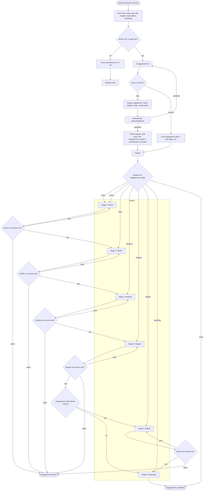

### 2.1 Mode → Stage Matrix

| Mode | Recon | OSINT | Analysis | Mapper | Exploit | Reporting |
|---|---|---|---|---|---|---|
| `recon` | ✓ | ✓ | – | – | – | ✓ (surface report) |
| `assess` | ✓ | ✓ | ✓ | ✓ | – | ✓ |
| `exploit` | ✓ | ✓ | ✓ | ✓ | ✓ | ✓ |
| `full` | ✓ | ✓ | ✓ | ✓ | ✓ (+ post-exploitation) | ✓ |

`exploit` mode validates vulnerabilities with PoCs; `full` additionally permits post-exploitation actions (privilege escalation, lateral movement, data access) subject to approval.

---

## 3. Stage Execution Shape (applies to all six)

Every stage is the same deterministic skeleton wrapping an LLM inner loop. This is the single most important architectural invariant: **stages are not free-form agents; they are bounded procedures with LLM assistance.**

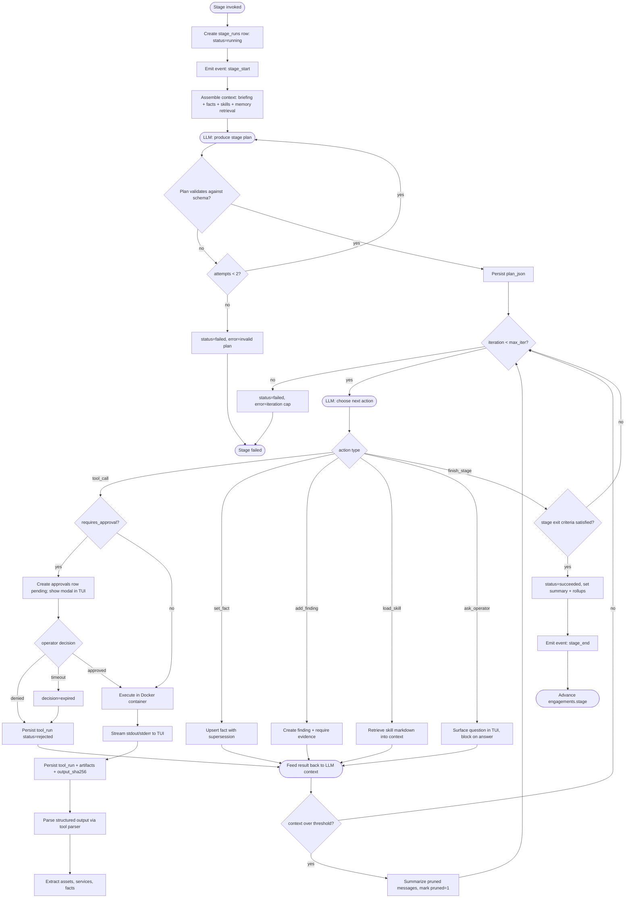

### 3.1 Exit Criteria per Stage

Deterministic predicates evaluated against the database. **The LLM cannot declare a stage complete; it can only propose completion, and the predicate decides.**

> **Authority:** `CORE.md §3.2` is normative. The table below is a readable summary of the same predicates; where the two ever disagree, CORE wins and this table is the bug.

| Stage | Exit predicate (all must hold) |
|---|---|
| **Recon** | Every seeded target has ≥ 1 `assets` row with `state='alive'`, **or** the stage recorded an explicit `unreachable` fact for it. Port scan completed for each alive host (or marked skipped with reason). |
| **OSINT** | ≥ 1 OSINT source consulted per root domain; `assets` expanded with at least the enumeration result (possibly empty, recorded as fact); no pending OSINT tool run. |
| **Analysis** | Every alive asset has at least one `facts` row for `web.tech` or `net.service_summary`; ≥ 1 hypothesis finding or an explicit `analysis.no_hypothesis` fact. |
| **Mapper** | `attack_nodes` non-empty; every `findings` row of severity ≥ medium is referenced by at least one `attack_edges` row or an explicit `unmapped` note; a ranked path to each declared goal exists or is proven absent. |
| **Exploit** | Every finding marked `verified=1` has a `poc` evidence row; every attempted exploit has a terminal `tool_runs` row; every opened `access_sessions` row is either active with a note or closed. |
| **Reporting** | `reports` row exists, artifact written, severity counts match a fresh query, and no `findings` row is `verified=1` without evidence. |

If a predicate cannot be satisfied, the stage ends `failed` with a structured reason, and the operator chooses retry / skip / abort. It never silently "succeeds".

---

## 4. Stage 1 — Recon

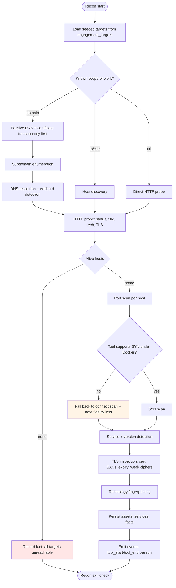

**Recon design notes**

| Concern | Decision |
|---|---|
| Passive before active | Always. Cheap, safe, and often yields the widest surface before any packet reaches the target. |
| Wildcard DNS | Detected once per root domain; without it, subdomain enumeration produces unbounded false positives. |
| SYN vs connect | Registry declares `NET_RAW` requirement. Docker Desktop's Linux VM cannot do host-level raw packets reliably; connect scan is the default and the fidelity loss is recorded as a `tool_defs.notes` caveat surfaced to the LLM. |
| Parallelism | Independent hosts scanned concurrently with a semaphore; a single host's tools run sequentially to avoid interfering results. |
| Idempotency | Re-running recon merges assets by `(kind, value)` and updates `last_seen_at`; it never duplicates. |

---

## 5. Stage 2 — OSINT

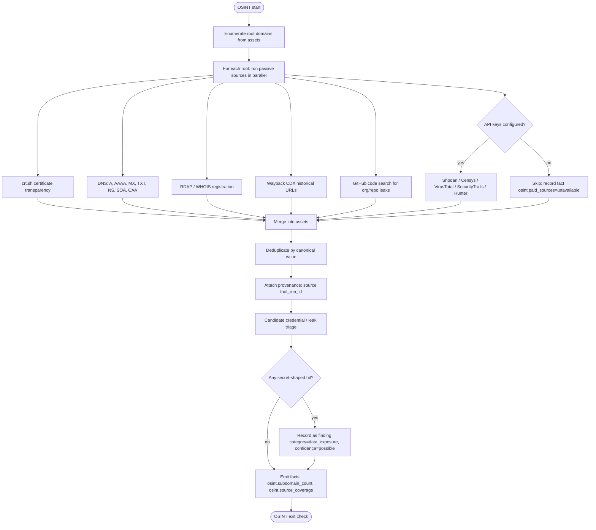

**OSINT design notes**

| Concern | Decision |
|---|---|
| Source independence | Each source is a separate tool with its own timeout and failure isolation. One source failing never fails the stage. |
| Provenance | Every discovered asset keeps `source` = tool id, so a report can attribute "found by crt.sh" vs "found by bruteforce". |
| Rate limits | Per-source token bucket in the executor; free sources get conservative defaults. |
| Leaked secrets | Recorded as `possible` confidence only. Verification is Analysis's job, never OSINT's. |
| No-key degradation | Explicitly recorded as a fact so the LLM does not hallucinate coverage it did not have. |

---

## 6. Stage 3 — Analysis

This is where reasoning models earn their cost. It is also where hallucination risk concentrates, so every claim must bind to persisted evidence.

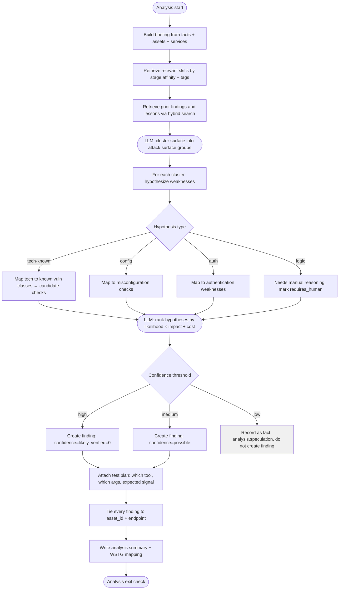

**Analysis design notes**

| Concern | Decision |
|---|---|
| No finding without a test plan | A finding created in Analysis is a *hypothesis*; it must carry the tool + args that would confirm or refute it. This makes Exploit mechanical rather than creative. |
| Evidence binding | Analysis findings have no tool evidence yet by definition; `verified` stays 0 and the report labels them "unvalidated". The Reporting stage refuses to call an unvalidated finding "confirmed". |
| Low-confidence discipline | Speculation is stored as a fact, not a finding. This keeps the report clean and prevents severity inflation. |
| Skill injection | Skills are retrieved by category affinity, not dumped wholesale — a 5 000-token skill on Active Directory is useless against a WordPress site and wastes budget. |
| WSTG mapping | The LLM proposes a `wstg_id`; a validator checks it against the embedded WSTG id list and blanks invalid values. |

---

## 7. Stage 4 — Mapper

Builds and ranks the attack graph. Deterministic graph algorithms do the ranking; the LLM supplies semantics (what an edge means) and the narrative.

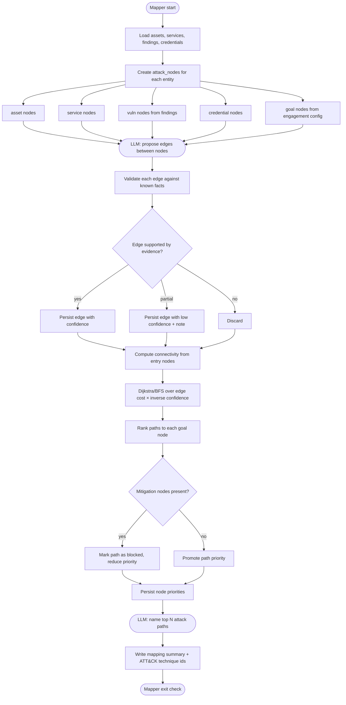

**Mapper design notes**

| Concern | Decision |
|---|---|
| LLM proposes, code validates | An edge with no supporting fact is discarded. This is the primary defense against the LLM inventing a network topology. |
| Ranking is deterministic | Cost and confidence come from the DB; `Dijkstra` in Go computes paths. The LLM only labels and narrates. Reproducible across runs. |
| Goals come from config | Defaults: domain admin / root, data access, public data exposure. Overridable per engagement. |
| Cycle handling | Graph traversal is cycle-safe; `attack_edges` uniqueness prevents duplicate parallel edges, and traversal tracks visited nodes. |
| Empty graph is valid | If nothing is exploitable, the mapper records that conclusion explicitly. "No path found" is a real, reportable result. |

---

## 8. Stage 5 — Exploit

Highest risk stage. Every action passes through the approval gate unless explicitly marked `safe`.

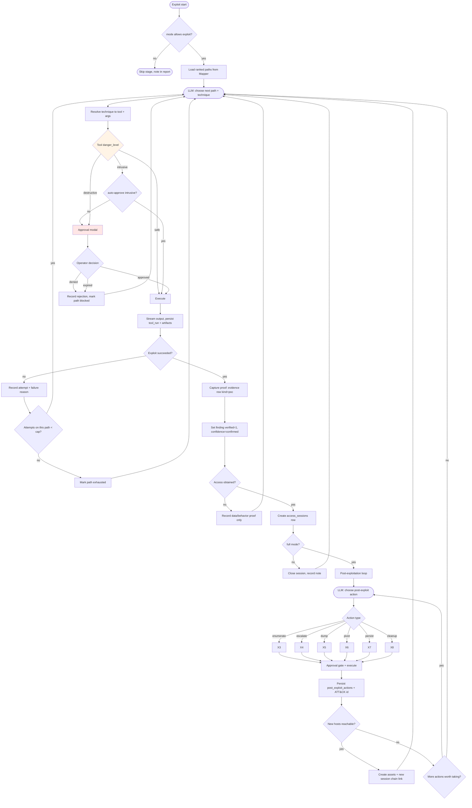

**Exploit design notes**

| Concern | Decision |
|---|---|
| Approval is per-action, not per-stage | The operator approves the specific command, seeing exact argv. Blanket stage approval is not offered. |
| Attempt cap | Per-path attempt cap (default 3) prevents the agent hammering a dead end and burning budget. |
| Verification is mechanical | A finding becomes `confirmed` only when a `poc` evidence row exists whose `tool_run.exit_code` is 0 **and** whose parsed output matches the tool's success signal. The LLM's opinion is not sufficient. |
| Credentials never enter context | The LLM references a `credential_id`; the executor resolves it at container launch. The model never sees the secret, so it cannot leak it into a report. |
| Session chain | Pivots create child `access_sessions` rows, giving a real attack-path record for the report's narrative. |
| Cleanup is an action | `cleanup` is a first-class post-exploit action so artifacts dropped on target can be removed and recorded. |
| Failure is data | A failed exploit attempt is persisted with its reason. Repeated failure across paths is itself a finding ("resilient configuration"). |

---

## 9. Stage 6 — Reporting

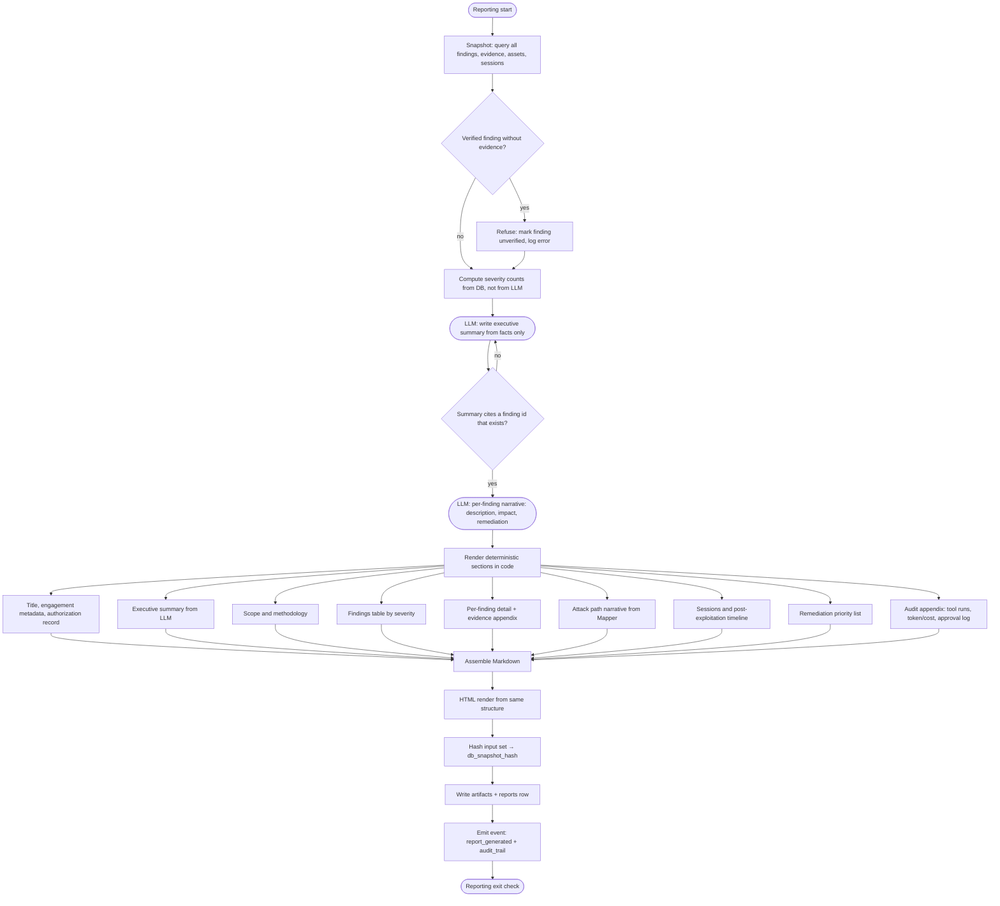

**Reporting design notes**

| Concern | Decision |
|---|---|
| Counts are computed, never generated | Severity totals come from `SELECT`. An LLM-written summary claiming "two critical" when the DB says three is a defect, so the count is injected into the prompt as fixed text. |
| Deterministic ordering | Findings sorted by severity, then CVSS descending, then ULID. Same DB → same document. |
| Refusal to fabricate | A finding with `verified=1` and no evidence aborts report generation with a clear error rather than shipping an unprovable claim. |
| Sensitive data | `artifacts.sensitive=1` excluded unless `--include-sensitive`. Credentials render as `username / (redacted)` only. |
| Regeneration | `cosmics report regenerate <id>` re-runs the deterministic path; the LLM summary is cached in `reports` unless `--refresh-narrative`. |

---

## 10. Interaction Flows

### 10.1 Operator pauses mid-stage

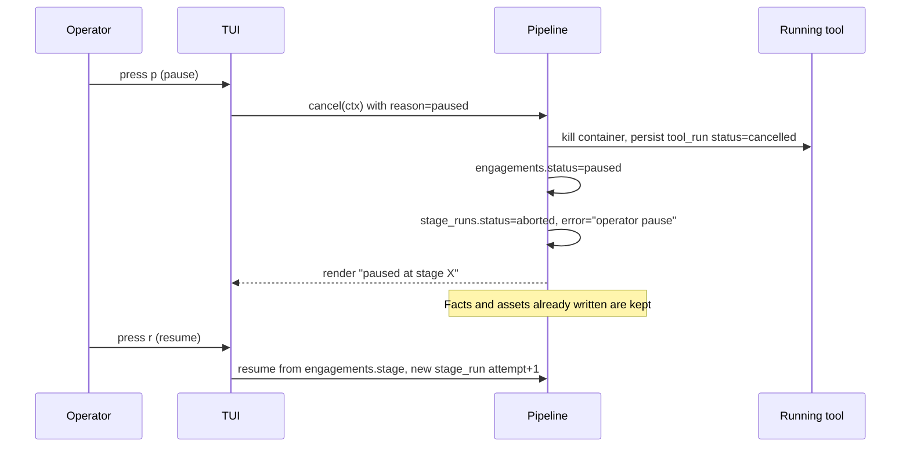

**Invariant:** pausing never discards partial results. Facts already extracted remain; the re-run merges rather than duplicating.

### 10.2 Destructive action approval

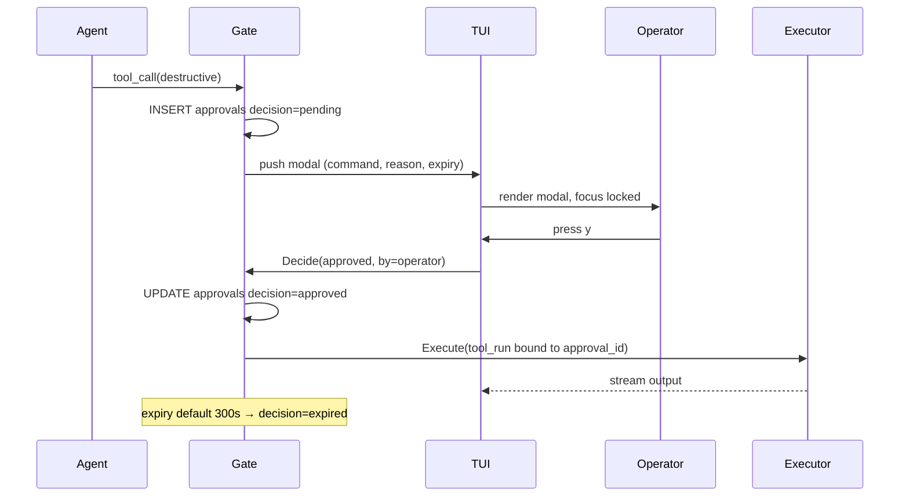

### 10.3 Crash recovery

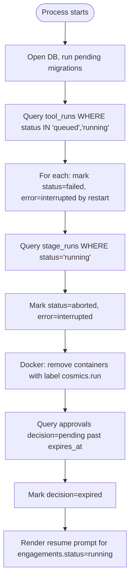

**Invariant:** startup reconciliation is unconditional and idempotent. A restart midway through a write must not leave a `running` row that blocks forever.

---

## 11. LLM Tool-Calling Loop (inner detail)

Every stage's decision step runs this loop.

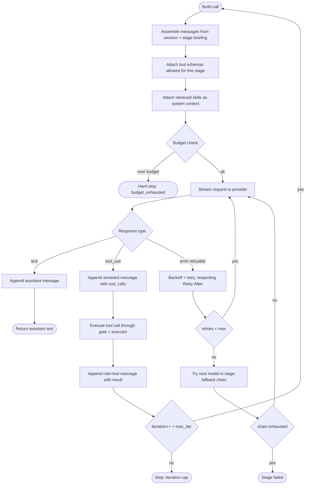

### 11.1 Stage Tool Allow-list

The LLM cannot call any tool it wants. Each stage exposes an explicit subset, enforced in code before execution.

| Stage | Allowed tool categories | Notes |
|---|---|---|
| Recon | `recon`, `network`, `web` (read) | No exploitation, no post-exploitation |
| OSINT | `osint` | Network egress to third parties only; no target scanning |
| Analysis | none (pure reasoning) + skill loading + fact writing | Analysis never touches the target |
| Mapper | none (pure reasoning) + graph writes | Deterministic graph algorithms supplied as functions |
| Exploit | `exploit`, `web`, `post` (if `full`) | Every `intrusive`/`destructive` call gated |
| Reporting | none + DB reads | Reporting never executes anything against a target |

**Rationale:** a stage-scoped allow-list converts a whole class of prompt-injection attacks into a no-op. A hostile HTTP response telling the agent to run `nmap` during Reporting has no such tool available.

---

## 12. Error Taxonomy & Handling

| Class | Example | Handling | Operator-visible |
|---|---|---|---|
| **Transient** | 429, 502, container pull timeout | Retry with exponential backoff + jitter, honor `Retry-After`, max 5 | Spinner, then "retrying (2/5)" |
| **Provider degrade** | Model 503 "all accounts unavailable" | Advance fallback chain, log `fallback_index` | Banner: "fallback to <model>" |
| **Tool failure** | nmap exits non-zero | Persist failure, feed stderr to LLM, let it choose an alternative | Activity stream shows red line |
| **Tool unavailable** | Image missing, binary absent | Structured error; registry suggests `cosmics tools install <id>` | Modal with fix command |
| **Plan invalid** | LLM returns malformed JSON | One repair attempt with the parse error appended, then fail the stage | Transcript shows the error |
| **Exit criteria unmet** | Recon found no live hosts | Stage `failed` with reason; operator chooses retry/skip/abort | Blocking choice prompt |
| **Budget** | 80% / 100% of token or USD budget | Warn at 80%, hard stop at 100% | Toast + status bar |
| **Approval timeout** | Operator away | `decision=expired`, tool_run `rejected`, agent told "denied by timeout" | Modal dismisses |
| **Fatal** | DB corrupt, schema mismatch | Abort process with exit code, preserve DB, print recovery steps | Full-screen error |
| **Cancellation** | Ctrl+C, pause | `context.Canceled` propagates to container kill and HTTP abort | Clean "cancelled" state |

---

## 13. Context Assembly (deterministic, inspectable)

Every LLM call is built from these blocks, in this order. The TUI can render the exact assembled prompt (`v` key in transcript).

```mermaid
flowchart LR
    A[1. System prompt: role, rules, safety hierarchy] --> B[2. Stage contract: goal, allowed tools, exit criteria]
    B --> C[3. Engagement briefing: synthesized facts summary]
    C --> D[4. Target facts: relevant subset by retrieval]
    D --> E[5. Retrieved skills: top-k by hybrid score]
    E --> F[6. Recent messages: unpruned tail]
    F --> G[7. Rolling compaction summary]
    G --> H[8. Current instruction / last tool result]
    H --> I[Assemble → token budget check → call]
```

| Block | Budget share | Source |
|---|---|---|
| System + contract | ~10% | Static templates in `internal/prompts` |
| Engagement briefing | ~15% | Deterministic synthesis from `facts` |
| Retrieved skills | ~20% | Hybrid retrieval over `skills` + `memory_chunks` |
| Recent messages | ~40% | `messages WHERE pruned=0 ORDER BY seq DESC LIMIT n` |
| Compaction summary | ~10% | `sessions.compaction_summary` |
| Current instruction | ~5% | Last tool result, truncated per policy |

**Truncation policy:** tool output over `tool_defs.max_output_bytes` is head/tail truncated with a marker `[truncated N bytes; artifact <id>]`. The full artifact stays on disk and can be re-read on demand via a `read_artifact` pseudo-tool.

---

## 14. State Machine Reference

### `engagements.status`

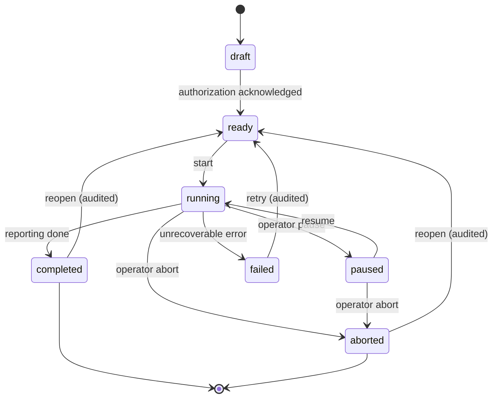

### `stage_runs.status`

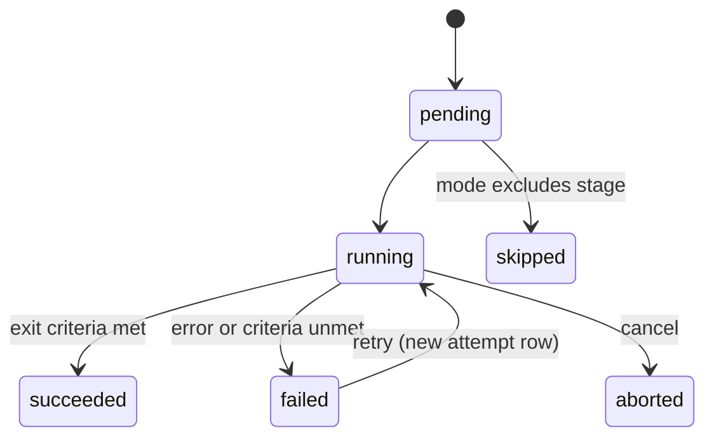

### `tool_runs.status`

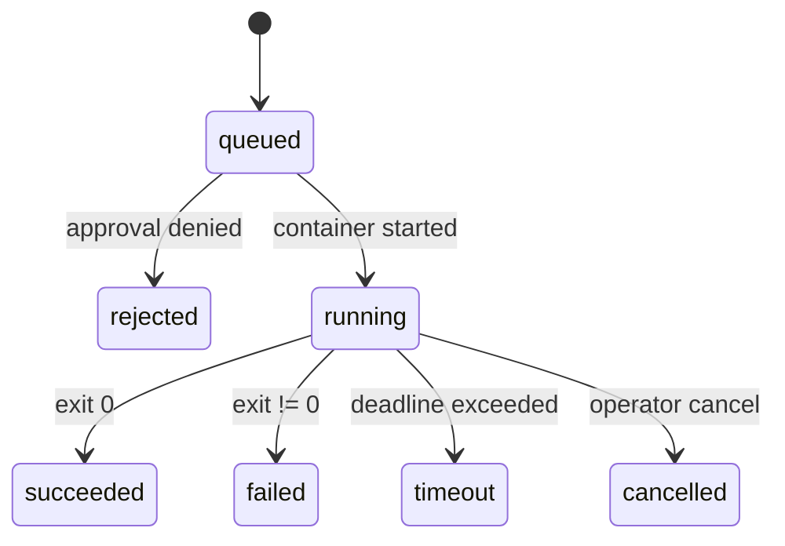

---

## 15. Invariants Checklist

These must hold at every point; each is testable.

1. A `finding` with `verified=1` always has ≥ 1 `evidence` row whose `tool_run_id` points to a `tool_runs` row with a non-null `output_sha256`.
2. A `tool_runs` row is never mutated after `finished_at` is set (trigger-enforced).
3. `audit_trail` contains an entry for every target ever touched and every exploit launched.
4. Deleting an engagement leaves `audit_trail` rows intact.
5. No credential plaintext appears in `messages.content`, `llm_calls.request_json`, `events.message`, or any rendered report.
6. A stage cannot advance while any of its `tool_runs` is `queued` or `running`.
7. Report severity counts equal a fresh `GROUP BY severity` query on the same snapshot.
8. Restarting mid-write leaves zero `running` tool runs and zero `pending` approvals past expiry.
9. An LLM call cannot reference a tool outside the current stage's allow-list.
10. Total `usage_ledger` cost equals the sum of `llm_calls.cost_usd_micros` for the engagement.
